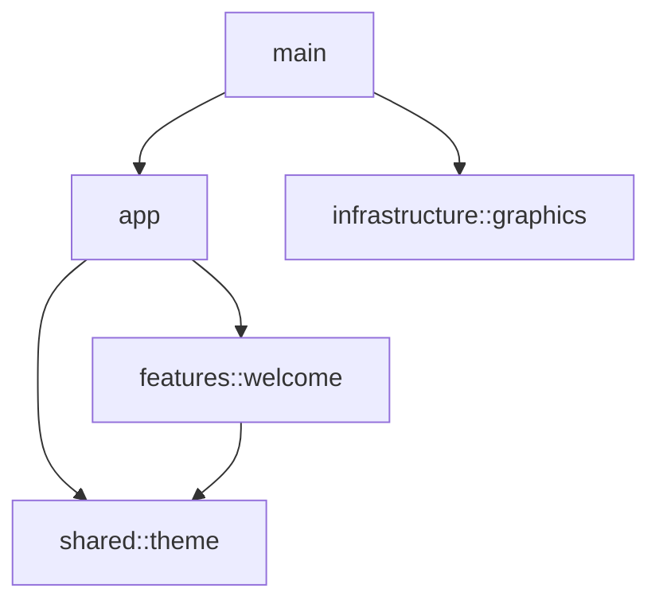

# Architecture

## Scope

lig currently provides a native greeting window and platform-specific graphics selection. The
application uses one Rust binary crate. Notes, editing, graph visualization, recording, and AI
processing remain future features. The repository contains no persistence or domain data yet.

## Modules

| Module                           | Responsibility                                                              |
| -------------------------------- | --------------------------------------------------------------------------- |
| `src/main.rs`                    | Connect the application and graphics launcher                               |
| `src/app/mod.rs`                 | Own application state, messages, window configuration, and Iced composition |
| `src/features/welcome.rs`        | Describe the greeting interface                                             |
| `src/shared/theme.rs`            | Define light-theme colors, spacing, typography, and surface effects         |
| `src/infrastructure/graphics.rs` | Select graphics backends and manage child processes                         |
| `tests/unit/`                    | Verify module behavior separately from production code                      |

## Dependencies

The entry point passes the application runner into the graphics launcher. Infrastructure does not
import feature modules. The welcome feature depends on shared presentation code. Shared presentation
code does not depend on application state.

## State and messages

The application follows The Elm Architecture. `Lig` owns application state. The current state
contains no persistent data. `Message` represents application events. The greeting screen currently
produces no messages. `update` processes messages. `view` delegates interface construction to the
welcome feature. The application creates no asynchronous tasks or subscriptions yet.

Add domain models only when features require them. Keep future domain models independent of Iced and
concrete infrastructure. Use application services when business operations need coordination.

## Presentation

The theme module owns all current styling values. Window dimensions belong to application
configuration. The current release uses a light theme. Dark themes and animations remain future
work. The glass surface stays opaque on every platform.

## Verification

Run `make check` and `make build` after changes. Separate test files preserve access through child
modules. Interface tests render without a display or GPU. Test graphics selection independently from
physical GPU availability. Check native rendering separately on each supported platform.

## Decisions

- [Module boundaries](adr/0001-module-boundaries.md)
- [Graphics fallback](adr/0002-graphics-fallback.md)

## Development rules

[AGENTS.md](../AGENTS.md) directs contributors to topic-specific rules in `docs/rules/`. Those files
define development requirements. This document describes the implemented application.
