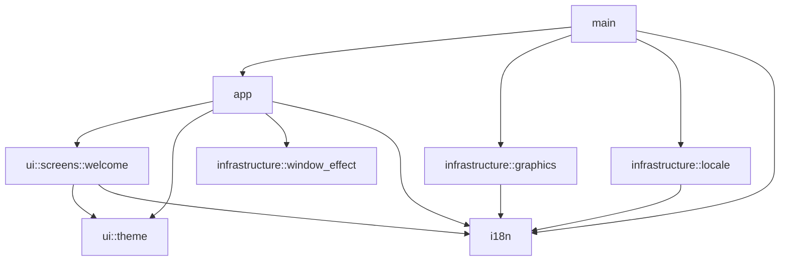

# Architecture

## Scope

lig uses a layered architecture within one Rust binary crate.
The application currently provides a localized greeting window and platform-specific graphics startup.
Documents, editing, graph operations, recording, and AI processing remain future capabilities.
The repository contains no persistence or business operations yet.

## Current structure

```text
src/
├── main.rs
├── app/
│   ├── mod.rs
│   └── tests.rs
├── ui/
│   ├── mod.rs
│   ├── screens/
│   │   ├── mod.rs
│   │   └── welcome/
│   │       ├── mod.rs
│   │       └── tests.rs
│   └── theme/
│       ├── mod.rs
│       └── tests.rs
├── i18n/
│   ├── mod.rs
│   └── tests.rs
└── infrastructure/
    ├── mod.rs
    ├── graphics/
    │   ├── mod.rs
    │   └── tests.rs
    ├── locale.rs
    └── window_effect.rs

locales/
docs/
```

| Module | Responsibility |
| --- | --- |
| `src/main.rs` | Select the startup language and connect the application with the graphics launcher |
| `src/app/mod.rs` | Own application UI state, messages, window configuration, and Iced composition |
| `src/ui/screens/welcome/mod.rs` | Describe the greeting screen |
| `src/ui/theme/mod.rs` | Define greeting typography, text color, and background fallback |
| `src/i18n/mod.rs` | Select supported languages and format embedded Fluent messages |
| `src/infrastructure/window_effect.rs` | Apply native Liquid Glass through the window handle |
| `src/infrastructure/locale.rs` | Read the language override and native system locale |
| `src/infrastructure/graphics/mod.rs` | Select graphics backends and manage child processes |
| `locales/` | Maintain English, Russian, and Spanish catalogs |
| Adjacent `tests.rs` files | Verify module behavior with access to private implementation |

## Current dependencies



Infrastructure and UI modules do not import each other.
The entry point supplies the localizer and application runner through explicit dependencies.
The localization module does not depend on Iced or operating-system access.

## Logic placement

`app` handles composition, application-wide UI state, and Iced message routing.
`ui` handles presentation and visual interaction state.
`infrastructure` handles concrete external operations.
`i18n` formats application messages.

Add `application/` when user operations need coordination beyond UI behavior.
Examples include creating documents, saving changes, and connecting nodes.
Add `domain/` when documents, graph data, invariants, or algorithms require independent logic.
Keep both layers independent of Iced and concrete infrastructure implementations.
Use contracts at real external boundaries when application scenarios need them.

Neither layer exists yet because the greeting screen has no business operations.
Likewise, add `ui/components/` when reusable components become necessary.
See [architecture rules](rules/architecture.md) for allowed dependencies and placement requirements.

## State and presentation

The interface retains The Elm Architecture: state, messages, update, and view.
`Lig` owns an immutable localizer and the native material readiness state.
The application stores no persistent data.
The current greeting screen produces no messages.
`view` delegates presentation to `ui::screens::welcome`.
An Iced subscription reports window creation.
The update function schedules native material initialization through `window::run`.
Iced executes this callback through its window event loop.
A completion message enables background transparency only after initialization succeeds.

Window dimensions belong to application configuration. The theme module owns styling values.
The application uses a dark theme and an initially opaque gray background.
The native material module requests Liquid Glass on macOS 26+ through `window-vibrancy`.
Other platforms and failed initialization retain the gray background.
See [the native material decision](adr/0005-native-window-material.md) for platform boundaries and verification limits.
See [internationalization](features/i18n.md) for language selection and fallback behavior.
Keep technical details outside the interface, following [user-facing content rules](rules/user-facing-content.md).

## Verification

Run `make check` and `make build` after changes unless the user explicitly defers execution.
Adjacent `tests.rs` files preserve private access through `#[cfg(test)] mod tests;` declarations.
Root `tests/` is reserved for integration tests through public interfaces or the executable.
The project has no integration tests yet, so that directory does not exist.
Interface tests run without a display or GPU.
Test graphics selection independently from physical GPU availability.
Check native rendering separately on each supported platform.

## Decisions

- [Layered architecture](adr/0004-layered-architecture.md)
- [Native window material](adr/0005-native-window-material.md)
- [Original module boundaries](adr/0001-module-boundaries.md), superseded by the layered structure
- [Graphics fallback](adr/0002-graphics-fallback.md)
- [Embedded localization](adr/0003-embedded-localization.md)

## Development rules

[AGENTS.md](../AGENTS.md) directs contributors to topic-specific rules in `docs/rules/`.
Those files define development requirements. This document describes the implemented application.
