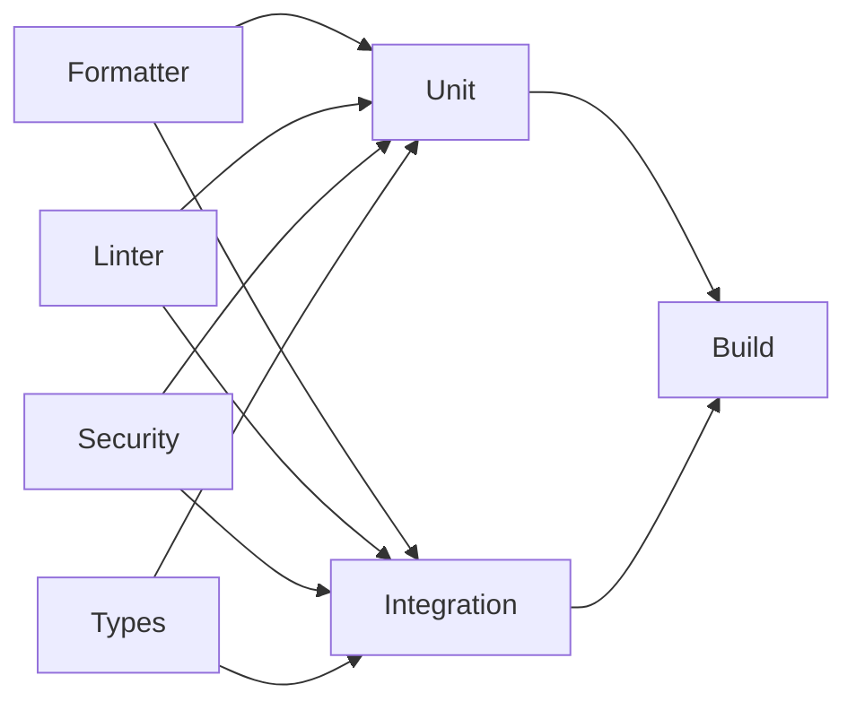

# Continuous integration

## Stage order

[The workflow](../.github/workflows/ci.yml) runs on pushes, pull requests, and manual dispatch.
GitHub Actions orders jobs through
[`needs`](https://docs.github.com/en/actions/reference/workflows-and-actions/workflow-syntax#jobsjob_idneeds)
dependencies. The workflow uses these dependencies to form three stages.

| Stage  | Jobs                                                 | Prerequisites                 |
| ------ | ---------------------------------------------------- | ----------------------------- |
| Checks | Formatter, Linter, Dependency security, Type checker | None                          |
| Tests  | Unit, Integration                                    | Every checks job must succeed |
| Build  | Release                                              | Both test jobs must succeed   |

Jobs within a stage run in parallel. A failed prerequisite prevents dependent jobs from starting.
Matrix failures do not cancel other jobs in that matrix. New runs cancel older runs for the same
workflow and Git reference.

## Platform coverage

Linter, type checker, unit tests, integration tests, and release builds run on all supported
platforms. Their matrix uses `macos-latest`, `windows-latest`, and `ubuntu-24.04`. Formatter and
dependency security run on `ubuntu-24.04`. The security job audits the complete lockfile, including
dependencies for other platforms.

[The shared setup action](../.github/actions/setup-rust/action.yml) installs Rust 1.90.0 and Linux
native build dependencies. Calling jobs must check out the repository before invoking this local
action. External actions retain pinned commit references. The workflow grants only repository read
access.

## Commands

| Job                 | Command                                                             |
| ------------------- | ------------------------------------------------------------------- |
| Formatter           | `cargo fmt --all -- --check` and dprint 0.64.3                      |
| Linter              | `cargo clippy --locked --all-targets --all-features -- -D warnings` |
| Type checker        | `cargo check --locked --all-targets --all-features`                 |
| Dependency security | `cargo audit --file Cargo.lock` with cargo-audit 0.22.2             |
| Unit                | `cargo test --locked --all-features --bin lig`                      |
| Integration         | `cargo test --locked --workspace --all-features --test '*'`         |
| Release             | `cargo build --locked --release`                                    |

The unit job runs the binary's adjacent `tests.rs` modules, including headless interface tests. The
integration job selects only Cargo integration test targets. Cargo's
[`--tests` option](https://doc.rust-lang.org/cargo/commands/cargo-test.html#target-selection) also
selects unit tests, so this job uses `--test '*'`.

## Missing and future tests

The repository currently has no integration test targets. Each integration job reads Cargo metadata
before selecting tests. Without integration targets, it skips the execution step and records that no
integration tests ran. That successful discovery job allows the release stage to proceed. Metadata
failures fail the job.

Adding an integration target under root `tests/` enables its execution automatically. Discovery also
recognizes integration targets declared explicitly in Cargo manifests. Test failures fail the job
and block release builds.

Add dedicated jobs when additional test categories become necessary. When adding library targets,
extend the unit job to run their tests. Add documentation test jobs when library documentation
contains executable examples. Update build prerequisites when adding required test jobs. Keep check
requirements in [the quality rules](rules/quality.md).

## Verification limits

Native builds check compilation and linking on each platform. Headless tests do not verify Liquid
Glass appearance or every graphics backend. Check native rendering separately with the application
window. GitHub executes the complete platform matrix after a push or pull request update.
